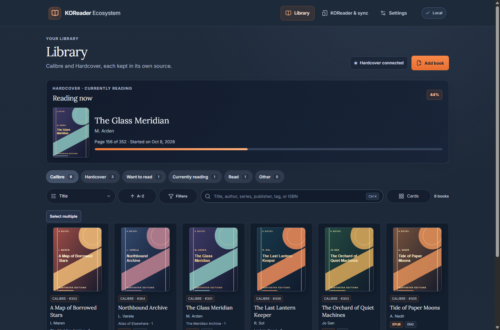
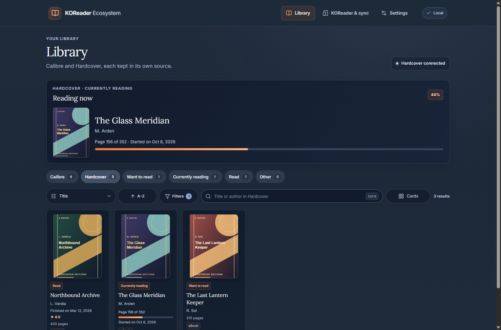
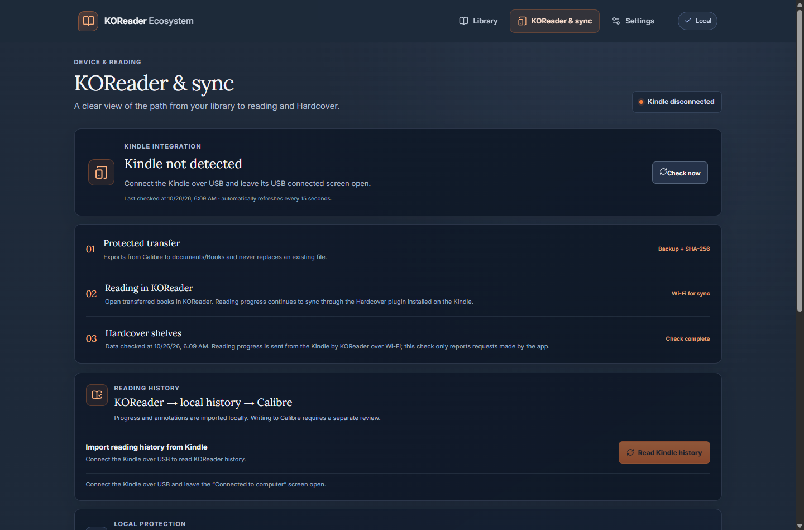
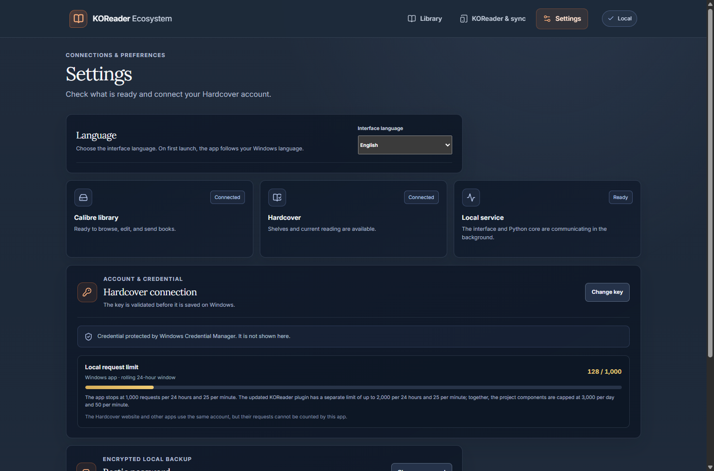

<div align="center">
  
  <h1>KOReader Ecosystem</h1>
  <p><strong>Your books, your reader, and your reading progress — together.</strong></p>
  <p>A local-first Windows companion for Calibre, Kindle with KOReader, and Hardcover.</p>
  <p>
    <a href="https://github.com/bellussi1/koreader-ecosystem/releases/latest"></a>
    <a href="https://github.com/bellussi1/koreader-ecosystem/actions/workflows/ci.yml"></a>
    <a href="https://github.com/bellussi1/koreader-ecosystem/actions/workflows/desktop.yml"></a>
    <a href="https://github.com/bellussi1/koreader-ecosystem/actions/workflows/secrets.yml"></a>
    <a href="https://github.com/bellussi1/koreader-ecosystem/stargazers"></a>
    <a href="LICENSE"></a>
    
  </p>
</div>

<p align="center"><a href="README.md">English</a> | <a href="README.pt-BR.md">Português (Brasil)</a></p>

<p align="center"><a href="https://github.com/bellussi1/koreader-ecosystem/releases/latest"><strong>Download for Windows</strong></a> · <a href="#first-time-setup">Get started</a> · <a href="#feature-status">Features</a> · <a href="#screenshots">Screenshots</a> · <a href="#contributing">Contribute</a></p>



Keep your Calibre library and Hardcover shelves within reach. Browse your books, edit metadata, send an ebook to your Kindle, and back up your data from a Windows desktop app. A KOReader plugin can send your reading progress to Hardcover over Wi-Fi.

> **Early-stage project:** Individual Kindle transfers have been tested, but the complete reading and synchronization cycle still needs validation on a physical device. See [feature status](#feature-status) and the [roadmap](docs/en/roadmap.md).

## Start here

1. **Install** the [latest Windows release](https://github.com/bellussi1/koreader-ecosystem/releases/latest) and locate your Calibre library.
2. **Connect** your Hardcover account in Settings and configure the KOReader plugin on your reader.
3. **Manage your library:** edit a book, send it over USB, or review your Hardcover shelves.

See [first-time setup](#first-time-setup) and [common workflows](#common-workflows) for details.

## How it works

```text
 Calibre library ──USB──> Kindle + KOReader ──Wi-Fi──> Hardcover
       │                           │                       │
       └────────── KOReader Ecosystem on Windows ──────────┘
                browse · manage · review · back up
```

Your book files remain in Calibre. The app connects to the Kindle over USB and to Hardcover over the internet. A separate KOReader plugin sends reading progress over Wi-Fi; the Windows app can stay closed while you read.

## What the app does

- 📚 **Browse your library:** find Calibre books by title, author, or filters; add a file and edit supported metadata or covers.
- 📖 **Explore your shelves:** see your Hardcover lists and most recently updated current read.
- ↗️ **Send a book to Kindle:** transfer a selected file over USB with a backup, collision protection, and verification.
- 🔄 **Track your reading:** use the KOReader plugin to send progress to Hardcover over Wi-Fi. Import local reading history for review in the app.
- 🗂️ **Move reading history:** map and review CSV files from Goodreads, StoryGraph, or Maratona. Export a confirmed batch in Goodreads-compatible format.
- 🔒 **Back up locally:** create encrypted Restic snapshots and restore them to a new folder.

The app has three pages: **Library**, **KOReader & sync**, and **Settings**. Calibre, Hardcover, and KOReader remain separate sources of truth.

## Feature status

“Available” means available in the current app within the scope shown. “Partial” means the feature has limits or still needs an acceptance check on the real workflow.

| Feature | Status | Current scope |
| --- | --- | --- |
| Calibre catalog | Available | Browse covers, search, sort, filter, and paginate books. |
| Add and edit Calibre books | Partial | One-file imports; common metadata, covers, eligible single-value custom fields, and reviewed batch tag changes. Writes require a backup and reread. |
| Hardcover shelves | Available | Read-only shelves, current reading, digital-edition filters, and a local cache within the API budget. |
| Hardcover queue | Partial | Manually confirmed recovery of up to four safe actions, with per-action review for ambiguous submissions. Journal text is never shown; resolution is local and does not change Hardcover. |
| KOReader reading history | Partial | Import local events and annotations for review; complete cross-service synchronization is not validated. |
| Reading history CSV | Available locally | Reviewable English/Portuguese column mapping, paginated preview, explicit local confirmation, Calibre/Hardcover match suggestions by identifiers or title + author, and Goodreads-compatible export. Suggestions never auto-link or sync. |
| Kindle USB/MTP transfer | Partial | Individual transfers have been verified on a physical Kindle. General batch/reconnection behavior and sidecar restoration still need validation. |
| Encrypted backup and restore | Available locally | Restic snapshots and restore to a new folder are supported. Remote backup and independent recovery remain pending. |
| Ratings, journal notes, and edition changes | Manual / separate | These remain user-controlled Hardcover actions. Calibre metadata edits do not change Hardcover records. |

## Screenshots

These are captures of the current React interface using fictional demo books and account state. They contain no personal library or credentials.

| Hardcover shelves | KOReader and sync |
| --- | --- |
|  |  |



The interface is available in English and Brazilian Portuguese. Choose the language in **Settings → Interface language**; on first launch, the app follows the Windows language. Screenshots use fictional demo books and account state.

## Download for Windows

Download the [installer, portable ZIP, and SHA-256 hashes](https://github.com/bellussi1/koreader-ecosystem/releases/latest) from the release page. To build from source, see the [contribution guide](CONTRIBUTING.md).

For the ZIP package, extract the entire folder and run `KOReaderEcosystem.exe` from inside it; the executable needs the other package files. Verify the SHA-256 values in `SHA256SUMS.txt` before running the downloads. The installer is not digitally signed, so Windows may show an unknown-publisher warning.

## First-time setup

1. Install Calibre and confirm the location of your library. App settings are stored under `%LOCALAPPDATA%\KOReaderEcosystem`. Existing profiles and Credential Manager entries are carried forward on first launch after upgrading.
2. Open **KOReader Ecosystem** and go to **Settings**.
3. To view Hardcover shelves, create your own API key in [Hardcover API settings](https://hardcover.app/account/api), enter it in the app's masked field and choose **Connect**. The app validates the key and stores it in Windows Credential Manager; it is not shown again. The [KOReader plugin](https://github.com/Billiam/hardcoverapp.koplugin) needs its own configuration on the reader; keep that device configuration private.
4. In **Settings**, save the Restic repository password in Windows Credential Manager and keep a copy in a separate password manager. The app validates a replacement password against the repository before saving it. Check the backup destination; remote backup and independent recovery have not yet been validated.
5. Close Calibre before adding or editing books. The library can be read while Calibre is open, but writes require Calibre to be closed.

**Library location:** The app does not yet offer a first-run folder picker ([issue #24](https://github.com/bellussi1/koreader-ecosystem/issues/24)). Its default is `%USERPROFILE%\Biblioteca do calibre`. For another location, close the app and set `calibre_library` in `%LOCALAPPDATA%\KOReaderEcosystem\config.json`, preserving any other fields. If the file does not exist, create it with a JSON object such as:

```json
{ "calibre_library": "C:\\Books\\Calibre Library" }
```

The `READING_CALIBRE_LIBRARY` environment variable takes precedence when set. Do not place passwords or API keys in this file.

Never commit API keys, the Restic password, book files, `metadata.db`, `.sdr` sidecars, logs, or backup data.

## Common workflows

### Add or edit a book

On the **Library** page, choose **Add book** and select a file. Review possible duplicates and explicitly choose whether to create a new record or attach the format to an existing record. To edit a book, open **Edit**, change the available fields, and save. The app creates a Calibre backup before writing and rereads the record afterward.

The editor does not change Hardcover shelves. It supports covers and editable single-value custom fields; multi-value and calculated fields remain unavailable. Imports are limited to one file at a time. Batch tag changes require review and a verified backup.

### Send a book to Kindle

1. Connect the Kindle over USB, leave it on the **USB connected** screen, and close KOReader on the device.
2. On the **Library** page, choose **Send** on a book and select an available Calibre format.
3. Review the destination filename and confirm **Create and verify backup, then send**.
4. Wait for the transfer to finish. Eject the Kindle through Windows before unplugging it, then open the book in KOReader.

The transfer uses WPD/MTP and does not depend on a drive letter. Existing files are never overwritten. A filename collision requires a different name. If verification reports an uncertain result, inspect the device before retrying. Individual transfers have been verified on a physical Kindle; general batch/reconnection behavior and KOReader sidecar restoration still need validation.

### Sync reading progress to Hardcover

1. Eject the Kindle and unplug USB. Open KOReader with Wi-Fi available.
2. In the KOReader Hardcover menu, link the book to the correct Hardcover record and edition. If you read a Portuguese edition but track an original English print edition, choose the edition whose progress you want to update and check the pagination.
3. Enable **Track progress** for the book. KOReader sends progress to Hardcover over Wi-Fi; the Windows app can remain closed.
4. To finish a book, mark it as finished in KOReader. Check the status and dates on Hardcover, then refresh the app's shelves.
5. Journal entries and ratings remain manual actions.

Choose the Hardcover edition carefully, even when you read a different ebook edition. On the current development branch, EPUB progress is calculated from the KOReader reading position and converted to a page in the selected Hardcover edition; the page count must be available and the edition must match. The latest release may not include this change yet. Conflict review and a real end-to-end test are still required.

### Import or export reading history

In **Library**, choose **CSV history**, select Goodreads, StoryGraph, or Maratona as the source, then choose a CSV. Check the suggested column mapping (title and author are required), adjust any field that does not match your file, and choose **Preview using these columns**. Review the counts, warnings, and book rows before choosing **Confirm and save locally**. The import is stored in the local app database; it does not change Hardcover or Calibre.

Select an applied batch in **Recent imports** to export a Goodreads-compatible CSV. The save dialog asks where to write it. Reviews are omitted by default; check **Include reviews in this file** only when you want them in that export. Private Notes are never exported. CSV interchange does not yet link imported rows to Hardcover or Calibre editions, or synchronize them automatically.

## Data, privacy, and availability

- **Calibre** owns book files, editions, bibliographic metadata, and covers.
- **KOReader** owns reading position and communicates with the Hardcover plugin.
- **Hardcover** owns online shelves, editions, and reading history.
- The app and Python service run locally on Windows when the app is open. A hosted service cannot directly access the local Calibre library or a Kindle connected over WPD/MTP.
- The Restic password and Hardcover key are stored in Windows Credential Manager. App settings and local state live under `%LOCALAPPDATA%\KOReaderEcosystem`.
- Check where your Restic repository is stored. A backup on the same disk as its sources cannot protect against disk loss; remote backup and independent recovery remain pending.
- KOReader sends reading updates directly to Hardcover over Wi-Fi. USB is required for local Kindle tasks such as file transfer and sidecar backup.

Git should contain source code, documentation, and non-personal defaults only. Do not commit personal book data, credentials, or backups.

## Development

The Electron app packages a React interface and a Python sidecar. The Python package also retains a CLI and a legacy PySide6 UI for flows not yet migrated, such as KOReader–Calibre preview and advanced recovery. Do not remove those modules until their flows have been migrated and validated.

### Requirements

- Windows x64
- Node.js 24.15 or later in the 24.x series, or 26 or later and npm
- Python 3.14 and `uv`
- PowerShell 7
- Git

### Set up the development environment

```powershell
uv sync --all-groups
npm --prefix desktop ci
```

### Checks and packaging

```powershell
uv run pytest -q
uv run ruff check .
uv run ruff format --check src tests
uv run mypy
npm --prefix desktop test -- --run
npm --prefix desktop run typecheck
npm --prefix desktop run lint
npm --prefix desktop run make
```

## Contributing

You can help with documentation, translations, accessibility, automated tests, and device compatibility. Browse the [open issues](https://github.com/bellussi1/koreader-ecosystem/issues) or [good first issues](https://github.com/bellussi1/koreader-ecosystem/labels/good%20first%20issue), share a proposal on the relevant issue, and read the [contribution guide](CONTRIBUTING.md) before opening a pull request. Use fictional data in examples and keep device-specific validation separate from automated tests.

The [roadmap](docs/en/roadmap.md) tracks work in progress, including device reliability, provider integrations, and backup recovery. Please report security concerns privately using the [security policy](SECURITY.md).

## Documentation

- [English documentation index](docs/en/README.md)
- [Architecture and operation](docs/en/architecture.md)
- [Windows app guide](docs/en/desktop-app.md)
- [Backup and recovery](docs/en/backup-recovery.md)
- [Release process](docs/en/releasing.md)
- [Roadmap](docs/en/roadmap.md)
- [Contributing](CONTRIBUTING.md)
- [Code of conduct](CODE_OF_CONDUCT.md)
- [Security policy](SECURITY.md)
- [Português (Brasil)](README.pt-BR.md)
- [Guia de contribuição em português](CONTRIBUTING.pt-BR.md)
- [Política de segurança em português](SECURITY.pt-BR.md)

The original project code is licensed under the [MIT License](LICENSE). Bundled third-party software and assets retain their respective licenses; see [third-party notices](licenses/THIRD-PARTY-NOTICES.txt).

## Names and compatibility

The product, Python package, desktop service, and repository use the **KOReader Ecosystem** name. Upgrade migration preserves local settings, stored credentials, and existing Restic snapshots from earlier releases. Kindle remains in the documentation only where it identifies the physical device or its USB transfer protocol.
