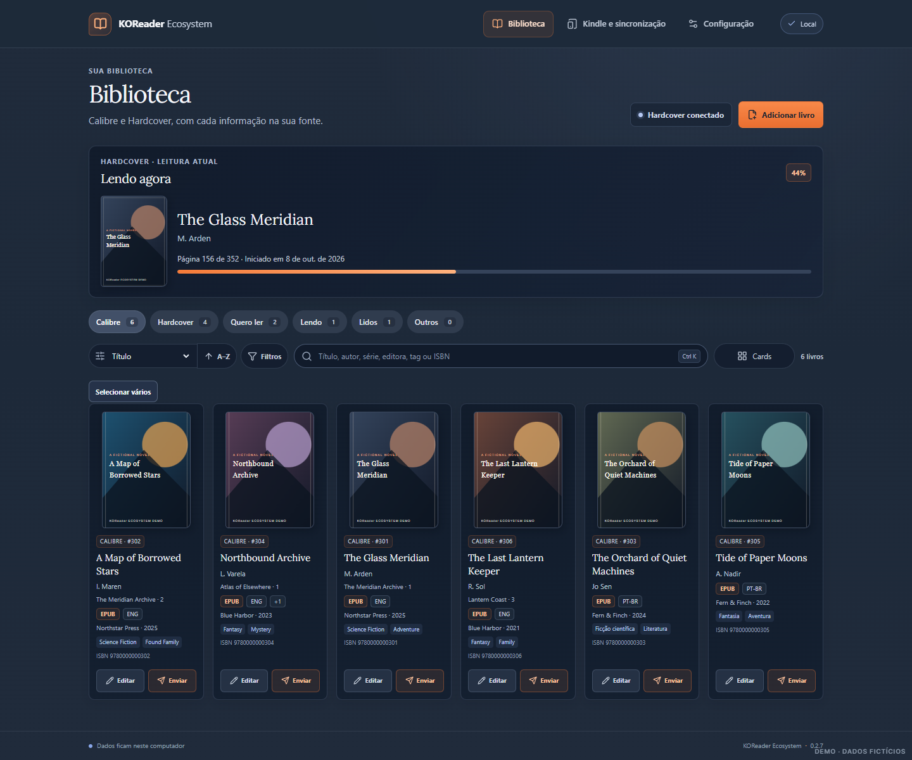
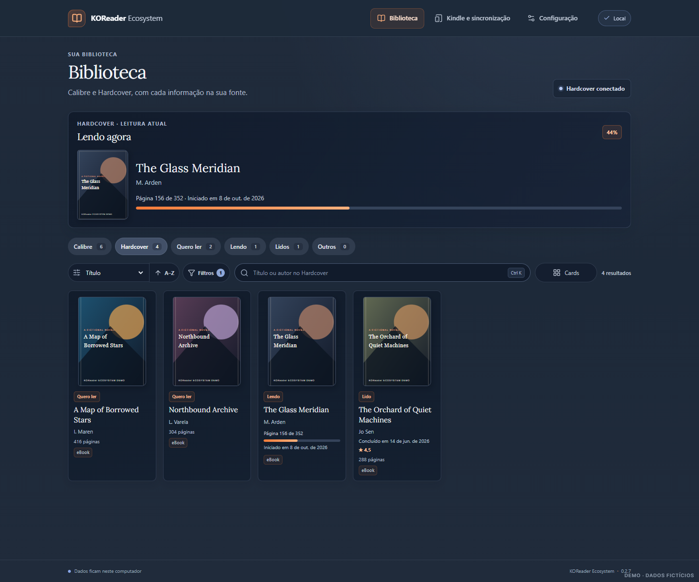
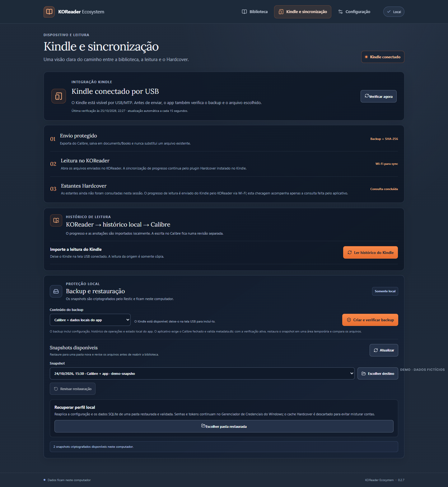
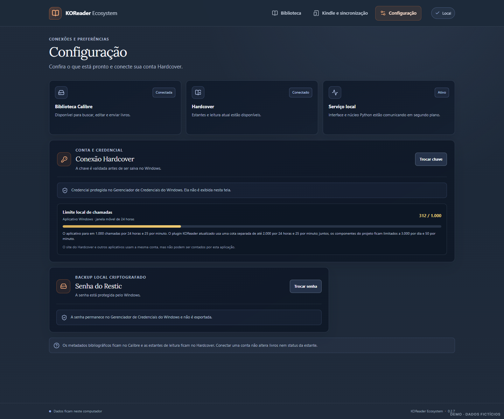

<div align="center">
  
  <h1>KOReader Ecosystem</h1>
  <p>Aplicativo local para Windows que conecta Calibre, Kindle/KOReader e Hardcover.</p>
  <p>
    <a href="https://github.com/bellussi1/koreader-ecosystem/releases/latest"></a>
    <a href="https://github.com/bellussi1/koreader-ecosystem/actions/workflows/ci.yml"></a>
    <a href="https://github.com/bellussi1/koreader-ecosystem/actions/workflows/desktop.yml"></a>
    <a href="https://github.com/bellussi1/koreader-ecosystem/actions/workflows/secrets.yml"></a>
    <a href="https://github.com/bellussi1/koreader-ecosystem/stargazers"></a>
    <a href="LICENSE"></a>
    
  </p>
</div>

<p align="center"><a href="README.md">English</a> | <a href="README.pt-BR.md">Português (Brasil)</a></p>

<p align="center"><a href="#baixar-para-windows">Baixar</a> · <a href="#primeira-configuração">Começar</a> · <a href="#capturas-de-tela">Capturas</a> · <a href="#como-contribuir">Contribuir</a> · <a href="docs/roadmap.md">Roadmap</a></p>



Tenha sua biblioteca Calibre e suas estantes Hardcover em uma interface. Pesquise livros, edite metadados, envie ebooks ao Kindle e proteja seus dados com backup no Windows. Um plugin separado do KOReader pode enviar seu progresso ao Hardcover pelo Wi-Fi, mesmo com o aplicativo Windows fechado.

A interface pode ser usada em **português do Brasil ou inglês**. Altere o idioma em **Configuração → Idioma**; na primeira abertura, o aplicativo segue o idioma do Windows.

> **Projeto em estágio inicial:** o ciclo completo KOReader–Hardcover e alguns fluxos USB precisam de mais testes no aparelho. Consulte o [estado das funcionalidades](#estado-das-funcionalidades) e o [roadmap](docs/roadmap.md).

## Comece por aqui

1. **Instale** a [versão mais recente para Windows](https://github.com/bellussi1/koreader-ecosystem/releases/latest) e localize sua biblioteca Calibre.
2. **Conecte** sua conta Hardcover em Configuração e configure o plugin no KOReader do seu leitor.
3. **Use sua biblioteca:** edite um livro, envie-o pelo USB ou consulte suas estantes no Hardcover.

Veja a [primeira configuração](#primeira-configuração) e os [fluxos de uso](#fluxos-de-uso) para mais detalhes.

## Como funciona

```text
 Biblioteca Calibre ──USB──> Kindle + KOReader ──Wi-Fi──> Hardcover
         │                          │                       │
         └────────── KOReader Ecosystem no Windows ─────────┘
                visualizar · organizar · revisar · proteger
```

Os arquivos permanecem no Calibre. O aplicativo acessa o Kindle conectado por USB e o Hardcover pela internet. O plugin do KOReader faz o envio do progresso por Wi-Fi e precisa de configuração própria no Kindle.

## O que o aplicativo faz

- **Biblioteca Calibre:** lista livros e capas, pesquisa, ordena, importa um arquivo por vez, edita metadados e capas, campos personalizados simples e permite revisar alterações de tags em lote.
- **Estantes Hardcover:** consulta Quero ler, Lendo e Lidos, mostra a leitura atual mais recentemente atualizada e filtra edições digitais. A edição e o status remotos são mantidos separados dos metadados Calibre.
- **Enviar ao Kindle:** exporta um formato da ficha Calibre e transfere pelo USB/WPD/MTP. A operação exige confirmação, backup anterior, não sobrescreve arquivos e tenta verificar a cópia por SHA-256.
- **Leitura no KOReader:** o aplicativo importa eventos e anotações locais para revisão; o plugin sincroniza progresso e datas com o Hardcover pela rede do Kindle. A sincronização direta funciona com o aplicativo Windows fechado.
- **Histórico CSV:** permite mapear cabeçalhos em inglês ou português antes de pré-visualizar arquivos Goodreads, StoryGraph ou Maratona. Só os valores mapeados são guardados; colunas ignoradas e notas privadas são descartadas, e resenhas não são importadas até você mapear a coluna explicitamente. Revise a prévia paginada e candidatos locais no Calibre/Hardcover; salve no computador ou exporte um lote confirmado no formato Goodreads. Nenhuma conta remota é alterada; resenhas mapeadas só entram na exportação se você optar.
- **Backup e recuperação:** a interface Electron cria snapshots Restic criptografados da biblioteca Calibre, dos dados locais do app e, quando o Kindle está em modo USB, também do dispositivo. Inclui cópia consistente do banco SQLite, configuração e histórico de operações; restaura para uma pasta nova, valida os arquivos e permite revisar a recuperação do perfil local com checkpoint. Backup remoto e recuperação independente ainda não foram validados.

O aplicativo tem três páginas: **Biblioteca**, **Kindle e sincronização** e **Configuração**. Calibre, Hardcover e KOReader continuam sendo fontes diferentes para seus próprios dados.

## Estado das funcionalidades

“Disponível” significa que funciona dentro do escopo descrito. “Parcial” indica limites conhecidos ou validação ainda pendente no fluxo real.

| Funcionalidade | Estado | Escopo atual |
| --- | --- | --- |
| Catálogo Calibre | Disponível | Capas, pesquisa, ordenação, filtros e paginação. |
| Adicionar e editar livros | Parcial | Importação de um arquivo por vez; metadados comuns, capas, alguns campos personalizados e revisão de tags em lote. Escritas exigem backup e releitura. |
| Estantes Hardcover | Disponível | Consulta das estantes, leitura atual, filtro de edições digitais e cache dentro do orçamento da API. |
| Fila Hardcover | Parcial | Recuperação com confirmação de até quatro ações seguras; inícios de leitura e notas ambíguos exigem revisão manual. A fila mostra somente contagens. |
| Histórico do KOReader | Parcial | Importa eventos e anotações locais para revisão; a sincronização completa entre serviços não foi validada. |
| Histórico CSV | Disponível localmente | Mapeamento revisável de cabeçalhos em inglês/português, prévia paginada, confirmação local explícita, sugestões de correspondência no Calibre/Hardcover e exportação no formato Goodreads. As sugestões nunca vinculam nem sincronizam automaticamente. |
| Transferência Kindle USB/MTP | Parcial | Transferências individuais foram verificadas em um Kindle físico. Lotes, reconexão e restauração de sidecars ainda exigem validação. |
| Backup criptografado e restauração | Disponível localmente | Restic cria snapshots e restaura para uma pasta nova. Backup remoto e recuperação independente continuam pendentes. |
| Notas, avaliações e troca de edição | Manual / separado | Continuam sob seu controle no Hardcover. Alterar metadados Calibre não altera os registros remotos. |

## Capturas de tela

As capturas mostram a interface React atual com livros e estados fictícios. Não contêm sua biblioteca nem credenciais.

| Biblioteca Calibre | Estantes Hardcover |
| --- | --- |
|  |  |

| Kindle e sincronização | Configuração |
| --- | --- |
|  |  |

## Baixar para Windows

Baixe o [instalador, o ZIP portátil e os hashes SHA-256](https://github.com/bellussi1/koreader-ecosystem/releases/latest) na página da release. Para compilar o código, consulte o [guia de contribuição](CONTRIBUTING.pt-BR.md).

No instalador, siga as etapas do Windows. Para usar o ZIP, extraia a pasta inteira e execute `KOReaderEcosystem.exe` dentro dela; o executável depende dos outros arquivos do pacote. Confira o SHA-256 informado em `SHA256SUMS.txt` antes de abrir. O aplicativo ainda não tem assinatura digital, então o Windows pode mostrar um aviso de publicador desconhecido.

## Primeira configuração

1. Instale o Calibre e confirme o local da sua biblioteca. A configuração local fica em `%LOCALAPPDATA%\KOReaderEcosystem`. Na primeira abertura após atualizar, o app migra o perfil e as credenciais da versão anterior.
2. Abra **KOReader Ecosystem** e vá a **Configuração**.
3. Para ver as estantes, crie sua chave nas [configurações de API do Hardcover](https://hardcover.app/account/api), cole-a no campo mascarado do aplicativo e escolha **Conectar**. O aplicativo valida a chave e guarda a credencial no Gerenciador de Credenciais do Windows. O [plugin do KOReader](https://github.com/Billiam/hardcoverapp.koplugin) precisa de configuração própria no aparelho; mantenha essa configuração privada.
4. Em **Configuração**, cadastre a senha Restic no Gerenciador de Credenciais do Windows e mantenha uma cópia em outro gerenciador. O aplicativo testa a senha contra o repositório antes de substituir uma credencial existente. Confira o destino do backup; a cópia remota e a recuperação independente ainda não foram validadas.
5. Feche a janela do Calibre antes de adicionar ou editar livros. A biblioteca pode ser lida com o Calibre fechado ou aberto, mas as escritas exigem que ele esteja fechado.

**Local da biblioteca:** Ainda não há um seletor de pastas na primeira execução ([issue #24](https://github.com/bellussi1/koreader-ecosystem/issues/24)). O padrão é `%USERPROFILE%\Biblioteca do calibre`. Para usar outro local, feche o aplicativo e ajuste `calibre_library` em `%LOCALAPPDATA%\KOReaderEcosystem\config.json`, preservando os demais campos. Se o arquivo não existir, crie um objeto JSON como este:

```json
{ "calibre_library": "C:\\Books\\Calibre Library" }
```

A variável de ambiente `READING_CALIBRE_LIBRARY`, quando definida, tem prioridade. Não coloque senhas ou chaves de API nesse arquivo.

Nunca publique chaves, senha Restic, arquivos da biblioteca, `metadata.db`, sidecars `.sdr`, logs ou cópias de backup.

## Fluxos de uso

### Adicionar ou editar um livro

Na página **Biblioteca**, selecione **Adicionar livro** e escolha um arquivo. Confira as possíveis duplicatas e escolha explicitamente criar um registro ou anexar o formato a um livro existente. Para editar um livro, abra **Editar**, altere os campos disponíveis e salve. O aplicativo cria um backup Calibre antes da gravação e relê a ficha depois.

O editor não altera a estante Hardcover. É possível editar capas e campos personalizados de valor único; campos múltiplos e calculados continuam disponíveis no Calibre. A importação ainda é de um arquivo por vez. Alterações de tags em lote exigem revisão e backup verificado.

### Enviar ao Kindle

1. Conecte o Kindle por USB, deixe-o na tela **USB conectado** e feche o KOReader no aparelho.
2. Na página **Biblioteca**, escolha **Enviar** e selecione o formato disponível na ficha Calibre.
3. Revise o nome do arquivo e confirme **Fazer backup verificado e enviar**.
4. Aguarde a conclusão. Ejete o Kindle pelo Windows antes de desconectar o cabo; depois abra o livro no KOReader.

A transferência usa WPD/MTP, sem depender de uma letra de unidade. Ela não substitui arquivos existentes. Uma colisão de nome pede outro nome; se a confirmação da cópia falhar, confira o Kindle antes de tentar de novo. Transferências individuais foram verificadas em um Kindle físico; lotes, reconexão e restauração de sidecars ainda exigem validação.

### Sincronizar leitura com Hardcover

1. Ejete o Kindle e desconecte o USB. Abra o KOReader com Wi-Fi disponível.
2. No menu Hardcover do KOReader, vincule o livro ao registro e à edição corretos. Se você lê em português, mas mantém no Hardcover a edição física original em inglês, selecione a edição que deve receber o progresso e confira a paginação.
3. Ative **Track progress** para o livro. O KOReader envia posição e atualizações de leitura ao Hardcover; o aplicativo Windows pode ficar fechado.
4. Para concluir, marque o livro como terminado no KOReader. Confira as datas e o status na conta Hardcover e depois atualize as estantes na aplicação.
5. Notas de diário e avaliações continuam sendo ações manuais suas.

Escolha a edição correta no Hardcover, mesmo que seu ebook seja de outra edição. Na versão de desenvolvimento, o progresso de EPUB usa a posição de leitura do KOReader e a converte para uma página da edição selecionada no Hardcover; a quantidade de páginas deve estar disponível e a edição precisa corresponder. A release mais recente pode ainda não incluir essa alteração. A revisão de conflitos e o teste real de ponta a ponta continuam necessários.

### Importar ou exportar histórico de leitura

Na **Biblioteca**, escolha **Histórico CSV**, selecione Goodreads, StoryGraph ou Maratona como origem e escolha um CSV. Confira o mapeamento sugerido das colunas (título e autor são obrigatórios), ajuste os campos que não correspondem ao arquivo e clique em **Pré-visualizar com estas colunas**. Depois revise contagens, avisos e livros antes de clicar em **Confirmar e guardar localmente**. A importação fica no banco local e não altera o Hardcover nem o Calibre.

Selecione um lote confirmado em **Importações recentes** para exportar um CSV compatível com Goodreads. A janela do Windows pergunta onde salvar. Resenhas são omitidas por padrão; marque **Incluir resenhas neste arquivo** só quando quiser incluí-las naquela exportação. Notas privadas nunca são exportadas. A troca CSV ainda não vincula linhas importadas a edições do Hardcover ou Calibre nem sincroniza esses serviços automaticamente.

## Dados, privacidade e disponibilidade

- **Calibre** mantém os arquivos, capas e metadados bibliográficos.
- **KOReader** mantém a posição de leitura e interage com o plugin Hardcover.
- **Hardcover** mantém suas estantes, edições e histórico online.
- O app e o serviço Python rodam localmente no Windows quando você os abre. Um serviço hospedado não consegue acessar a biblioteca local ou o Kindle conectado por WPD/MTP.
- A senha Restic e a chave Hardcover são armazenadas pelo Gerenciador de Credenciais do Windows. Configurações e estado local ficam em `%LOCALAPPDATA%\KOReaderEcosystem`.
- Confira onde está o repositório Restic. Um backup no mesmo disco dos arquivos de origem não protege contra perda do disco; backup remoto e recuperação independente continuam pendentes.
- A leitura via Wi-Fi é enviada pelo Kindle diretamente ao Hardcover. A conexão USB é necessária para tarefas locais do Kindle, como transferência de arquivos e cópia de sidecars.

O repositório versiona código e documentação. Não inclua dados pessoais de livros, credenciais ou backups em commits, issues ou releases.

## Desenvolvimento

O executável Electron empacota a interface React e um sidecar Python. O código Python também conserva a CLI e a aplicação PySide6 para operações ainda não migradas, como prévia KOReader–Calibre e recuperação avançada. Não remova esses módulos sem migrar e validar os fluxos correspondentes.

### Requisitos de desenvolvimento

- Windows x64
- Node.js 24 ou posterior e npm
- Python 3.14 e `uv`
- PowerShell 7
- Git

### Preparar o ambiente

```powershell
uv sync --all-groups
npm --prefix desktop ci
```

### Verificações estáticas e empacotamento

```powershell
uv run ruff check src tests
uv run mypy
npm --prefix desktop run typecheck
npm --prefix desktop run lint
npm --prefix desktop run make
```

O script `scripts/build-windows-app.ps1` gera a distribuição PySide6 legada; a aplicação Electron é empacotada pelos scripts npm em `desktop/package.json`. Consulte [docs/releasing.md](docs/releasing.md) antes de preparar uma release. Instaladores e ZIPs publicados ficam nos assets da GitHub Release, não no histórico Git.

## Como contribuir

Você pode ajudar com documentação, traduções, acessibilidade, testes automatizados e compatibilidade com dispositivos. Consulte as [issues abertas](https://github.com/bellussi1/koreader-ecosystem/issues), apresente sua proposta na issue correspondente e leia o [guia de contribuição](CONTRIBUTING.pt-BR.md) antes de abrir um pull request. Use dados fictícios nos exemplos e diferencie testes automatizados de validações no dispositivo.

O [roadmap](docs/roadmap.md) acompanha os trabalhos em andamento, incluindo confiabilidade no Kindle, integrações e recuperação de backups. Para relatar problemas de segurança, use os canais privados indicados na [política de segurança](SECURITY.pt-BR.md).

## Documentação

- [Documentação em inglês](docs/en/README.md)
- [Guia de contribuição](CONTRIBUTING.pt-BR.md) | [English](CONTRIBUTING.md)
- [Código de conduta](CODE_OF_CONDUCT.pt-BR.md) | [English](CODE_OF_CONDUCT.md)
- [Política de segurança](SECURITY.pt-BR.md) | [English](SECURITY.md)

- [Guia do aplicativo Windows](docs/desktop-app.md)
- [Arquitetura e operação](docs/architecture.md)
- [Backup e recuperação](docs/backup-recovery.md)
- [Como publicar uma release](docs/releasing.md)
- [Roadmap](docs/roadmap.md)

## Identificadores e compatibilidade

O produto, o pacote Python, o serviço do aplicativo e o repositório usam o nome **KOReader Ecosystem**. A atualização migra as configurações, credenciais e snapshots Restic das versões anteriores. “Kindle” aparece apenas quando descreve o aparelho ou a transferência por USB.

O código original está sob a [licença MIT](LICENSE). Componentes e recursos de terceiros mantêm suas próprias licenças; consulte os [avisos de terceiros](licenses/THIRD-PARTY-NOTICES.txt).
