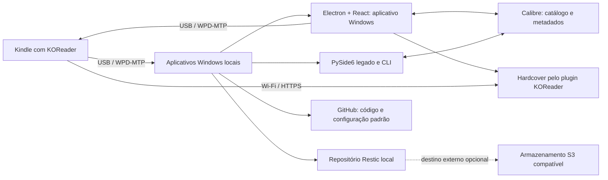

# Arquitetura e operação

## Resumo

O ecossistema não depende do ChatGPT/Codex aberto nem de um servidor web contínuo. A conexão USB do Kindle é WPD/MTP, acessível pelo Windows local; por isso, qualquer rotina automática de leitura USB precisa de uma ponte local. O armazenamento remoto pode hospedar cópias Restic criptografadas, mas não consegue ler o dispositivo enquanto ele está conectado ao computador.

## Fontes de verdade

- **Calibre:** arquivos dos livros, edições, metadados e capas.
- **KOReader:** progresso, posição, avaliações, destaques e notas.
- **Hardcover:** catálogo online e histórico social de leitura.
- **SQLite local:** o schema versionado `application-state.sqlite3` contém identidades, vínculos, cache remoto, lotes de importação, eventos/anotações, outbox, decisões de revisão, operações e quota. A versão 0.2.7 acrescenta cache persistente do Hardcover, registro de mutações para conferência após falhas e recuperação guiada do perfil do aplicativo a partir de uma restauração verificada; a versão 0.2.8 também renomeia o pacote e migra o perfil e as credenciais locais com segurança. A migração v5 registra decisões de revisão da outbox; a v6 registra o digest do mapeamento CSV e impede que um arquivo já importado substitua linhas com outro mapeamento. Credenciais permanecem fora do SQLite.
- **Restic:** snapshots criptografados da biblioteca Calibre, do estado local allowlisted do app e, quando disponível, do Kindle. A base principal é copiada pela Online Backup API e passa por `integrity_check`; a restauração temporária compara seu manifesto junto com os demais arquivos. O destino depende da configuração de cada usuário. O CLI aceita um espelho S3 configurado explicitamente, mas a restauração remota independente ainda precisa de validação.
- **GitHub:** código, documentação e configurações padrão. Livros, banco Calibre, sidecars, relatórios privados, tokens e backups não são versionados.

## Como as rotinas funcionam

O banco local também guarda importações CSV em lotes inativos até a confirmação. O renderer recebe uma lista limitada de metadados e avisos, sem resenhas ou notas privadas. A exportação usa o formato Goodreads; resenhas só entram quando você marca a opção, e o arquivo nunca recebe Private Notes. Esse fluxo não envia mudanças ao Hardcover ou Calibre.

1. Com o Kindle conectado e parado na tela USB, o adaptador Windows enumera e copia os arquivos acessíveis por MTP para staging temporário, relê o conteúdo para comparar SHA-256 e remove o staging ao terminar.
2. O backup local valida que o Calibre está fechado e que `metadata.db` está íntegro, cria cópias consistentes dos bancos SQLite locais pela API de backup do SQLite, cria o snapshot Restic, verifica o repositório e pode restaurar para uma pasta temporária para comparar os manifestos.
3. A prévia KOReader–Calibre existente lê sidecars sem executar Lua, cruza UUID exato ou ISBN válido e único, e grava um relatório HTML local. As gravações usam colunas KOReader dedicadas, snapshot verificado e leitura posterior dos valores.
4. A importação do histórico KOReader lê `statistics.sqlite3` e metadados `.sdr` por MTP para staging temporário, interpreta Lua como dados sem executá-lo e só persiste após confirmação. Eventos de página, snapshots de livro/sidecar e versões de anotação são mantidos no SQLite local. Sessões são agrupadas por uma lacuna de 30 minutos e marcadas como estimadas, pois KOReader não fornece IDs de sessão.
5. A projeção desse histórico no Calibre é separada: cada edição é vinculada manualmente, a prévia é revisada e a gravação exige Calibre fechado, snapshot Restic verificado e leitura posterior dos valores. A importação local não chama nem altera o Hardcover.
6. O plugin KOReader–Hardcover conversa diretamente com o serviço quando o Kindle tem rede. O patch incluído mostra o estado de sincronização, tenta novamente após falhas de conectividade, sinaliza conflitos e limita o uso local da API. Instalação e leitura real ainda precisam de validação no Kindle do usuário.
7. O executável consulta a presença MTP do Kindle em segundo plano a cada 15 segundos, sem inventariar arquivos. Quando o Windows informa que o armazenamento interno está pronto, as prévias e o backup completo ficam habilitados. A cópia e a gravação continuam explícitas.

O fluxo local de histórico faz parte da versão 0.2.6; cache, outbox e recuperação guiada do perfil fazem parte da 0.2.7. A versão 0.2.8 atualiza os identificadores do produto e leva o perfil local e as credenciais salvas para os novos nomes. A aceitação de transferência e sincronização completa em um Kindle físico continua pendente.

## Aplicativos Windows

A versão atual **Electron v0.3.7** inclui histórico KOReader local, projeção revisável para campos dedicados do Calibre, automações opcionais de backup local, cache/outbox Hardcover persistente e recuperação guiada do perfil nos snapshots Restic com cópia consistente do banco SQLite. Também impõe cotas locais às chamadas Hardcover e oferece reconciliação manual, limitada e revisão individual da fila. A automação de backup fica desligada por padrão; sua instalação no Agendador de Tarefas ainda precisa ser validada no Windows. A interface mantém status e formato dos livros em posições consistentes e está disponível em inglês e português do Brasil. Consulte [a página de Releases](https://github.com/bellussi1/koreader-ecosystem/releases) e [o guia do aplicativo](desktop-app.md) para os fluxos e limites atuais.

A aplicação **PySide6 legada** e a CLI continuam disponíveis para os fluxos que ainda não foram migrados, como a prévia KOReader–Calibre e operações de recuperação avançada. O bundle `dist/KOReaderEcosystem-next` é gerado localmente e não acompanha os assets da Release Electron; consulte `README.md` e `docs/LEIA-ME-EXECUTAVEL.txt` antes de usar essa versão.

Nenhuma dessas interfaces é um serviço em nuvem. Tarefas WPD/MTP precisam deste computador e do Kindle conectado. Já a sincronização KOReader–Hardcover ocorre diretamente do Kindle via Wi-Fi e não depende do app Windows aberto.

## Hospedagem e limites

O backup remoto é opcional e não vem configurado por padrão. A configuração de destino, o primeiro espelhamento e um teste de restauração remota independente dependem de o usuário escolher e configurar um serviço externo. O repositório Restic local não substitui uma cópia fora do computador. `backup` não faz chamadas de rede.

Um Worker ou dashboard hospedado não substitui a ponte Windows: serviços na nuvem não veem o Kindle em WPD/MTP nem a biblioteca local do Calibre. Um dashboard web completo é opcional e deve vir depois de estabilizar as sincronizações; o relatório HTML local atende à revisão nesta fase.

## Estado da release

A release `0.2.8` atualiza os nomes do aplicativo e do pacote e migra o perfil e as credenciais locais sem apagar as cópias antigas. A transferência e a leitura KOReader–Hardcover ainda exigem validação no aparelho de cada usuário; consulte as notas da release para os limites conhecidos.
