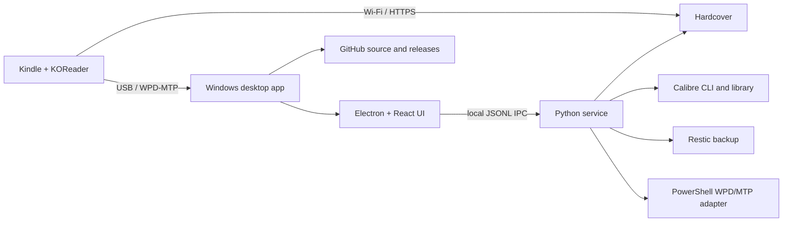

# Architecture and operation

[English](architecture.md) | [Português (Brasil)](../architecture.md)

## Overview

KOReader Ecosystem is a local Windows application. It does not require Codex, ChatGPT, or a continuously running web server. Kindle storage is accessed over Windows Portable Devices (WPD) and Media Transfer Protocol (MTP), so USB tasks need a local Windows process. KOReader can sync reading progress directly to Hardcover over Wi-Fi.

## Sources of truth

- **Calibre:** book files, editions, bibliographic metadata, and covers.
- **KOReader:** reading position and local reading state.
- **Hardcover:** online catalog, shelves, and reading history.
- **Local SQLite state:** the versioned `application-state.sqlite3` schema contains identities, links, remote cache, import batches, reading/annotation events, an outbox, review decisions, operations, and request quota. Version 0.2.7 adds persistent Hardcover cache, mutation records for failure reconciliation, and guided app-profile recovery from a verified restore; version 0.2.8 also renames the package and migrates the local profile and credentials safely. Migration v5 records outbox review decisions; v6 records the CSV mapping digest and prevents a previously imported file from replacing rows with a different mapping. Credentials remain outside SQLite.
- **Restic:** encrypted snapshots of the Calibre library, allowlisted app state, and optionally the Kindle when it is available over USB. Current development code copies the main database with SQLite's Online Backup API and runs `integrity_check`; temporary restore validation compares its manifest with the other backup sources.
- **GitHub:** source code, documentation, and non-personal defaults. Book files, Calibre databases, KOReader sidecars, credentials, and backups must not be committed.

Do not assume that books, editions, statuses, dates, ratings, or progress fields mean the same thing across services. Keep external record and edition identifiers when linking data.

## How the workflows run

The local database also stores CSV imports as inactive batches until confirmation. The renderer receives a bounded set of metadata and warnings without reviews or private notes. Export uses the Goodreads format; reviews are included only after an explicit choice, and the file never populates Private Notes. This flow does not send changes to Hardcover or Calibre.

1. With the Kindle connected on the USB screen, the Windows adapter inventories accessible MTP content and stages files temporarily. It rereads content to compare SHA-256 hashes before accepting the staging operation.
2. A local backup checks that Calibre is closed and that the Calibre database passes SQLite integrity validation. SQLite data is copied consistently, a Restic snapshot is created and checked, and an optional temporary restore can be compared with source manifests.
3. The existing KOReader–Calibre preview reads sidecars without executing Lua, matches by exact UUID or a unique valid ISBN, and creates a local HTML report. Writes use dedicated Calibre fields, a verified snapshot, and a read-back check.
4. KOReader history import reads `statistics.sqlite3` and `.sdr` metadata over MTP into temporary staging, parses Lua as data without executing it, and persists only after confirmation. Page events, book/sidecar snapshots, and annotation versions are stored in local SQLite. Sessions are grouped across a 30-minute inactivity gap and labeled estimated because KOReader provides no session IDs.
5. Projecting this history into Calibre is separate: each edition is linked manually, the preview is reviewed, and writes require Calibre to be closed, a verified Restic snapshot, and a read-back check. Local import does not call or update Hardcover.
6. The KOReader–Hardcover plugin talks directly to Hardcover when the Kindle has network access. The Windows app is not required for this Wi-Fi sync.
7. The Electron app checks for Kindle presence in the background. File copying and writing remain explicit actions with confirmation and validation.

The local history workflow is included in version 0.2.6; persistent cache/outbox and guided profile recovery are included in 0.2.7. Version 0.2.8 updates the product and package identifiers and carries forward the local profile and stored credentials. Physical-device acceptance for transfer and full reading sync is still pending.

## Windows applications

The current Electron v0.3.6 release packages a React UI and a Python sidecar, with local KOReader reading history, reviewable projection to dedicated Calibre fields, optional local backup automation, persistent Hardcover cache/outbox, bounded reconciliation, and per-action review. Backup automation is off by default; Task Scheduler installation still needs validation on this Windows profile. See the [Windows app guide](desktop-app.md) for supported workflows and limitations.

The legacy PySide6 UI and Python CLI remain available for flows not yet migrated, including KOReader–Calibre preview and advanced recovery. Do not remove those modules until their workflows have been migrated and validated.

The separately built legacy portable package has its own [usage guide](legacy-portable-bundle.md).

Neither desktop interface is a cloud service. WPD/MTP tasks need this Windows computer and a connected Kindle. KOReader–Hardcover sync runs directly from the Kindle over Wi-Fi.

## Hosting and limitations

A hosted dashboard cannot directly see the local Calibre library or a Kindle connected through WPD/MTP. A cloud storage provider can hold encrypted Restic data, but remote backup and an independent remote restore must be configured and validated separately.

The Restic destination depends on each user's configuration. A backup on the same physical disk as its sources can protect against some accidental changes, but not against loss of that disk.

## Project status

Release `0.2.8` updates the application identity and migrates the local profile and credentials while preserving the Calibre and KOReader workflows from 0.2.7. Release `0.2.9` adds English and Brazilian Portuguese UI selection, follows the Windows language on first launch, and includes localized library, sync, history, backup, and settings flows. Kindle transfer and the KOReader reading loop still require validation on each user's device and setup.
